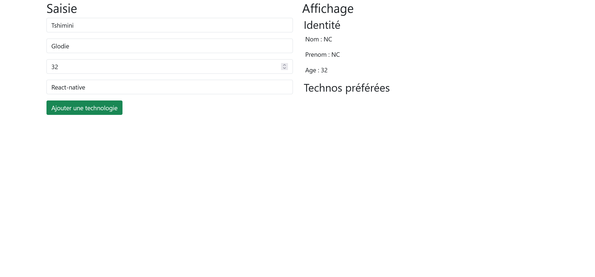

# Atelier 5.1 : la gestion des événements

## Enoncé

1. Récupérez [ce code HTML](./resources/5.1/index.html) qui servira du point de départ
2. À l'aide des événements et du DOM, affichez les informations saisies dans le formulaire de gauche en direct sur la partie droite du document HTML récupéré.

### Spécifications techniques

- Faire le lien entre le HTML et le JS
- Un langage ou une techno est ajouté à partir du bouton
- Les langages et les technos doivent être affiché sous la forme d'une liste à puces.
- Si l'âge est supérieur ou égal à 18 ans, affichez le message "vous êtes majeur(e)", sinon affichez "Vous êtes mineur(e)"

---

## Bonus

3. Désactivez le bouton "ajouter une technologie" lorsque le champ de saisie de la techno est vide.
4. Ajoutez des boutons de suppression aux technos ajoutées.

---

## Illustration

