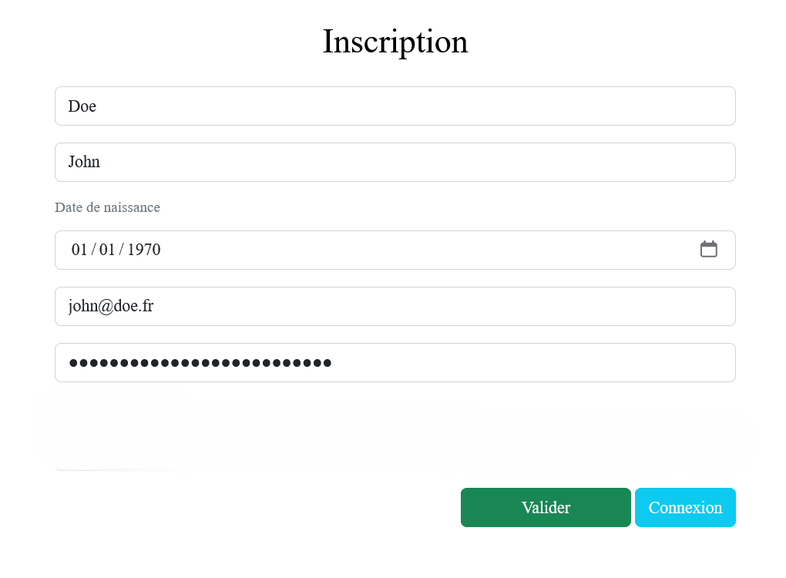
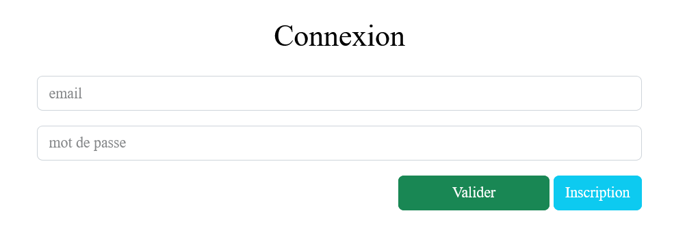

# Atelier 6.1 : les formulaires

## Warning

- **Pour cet exercice, ne vous attardez pas sur le CSS, encore mieux si vous en faîtes pas du tout**.
- **Ne traitez pas les champs pays et ville du formulaire d'inscription**

## Enoncé

1. A partir du code HTML ci-dessous, ajoutez dynamiquement un formulaire d'inscription en vous appuyant sur la [capture d'écran ci-dessous](#illustrations-photos)

```html
<!DOCTYPE html>
<html lang="fr">
<head>
    <meta charset="UTF-8">
    <meta name="viewport" content="width=device-width, initial-scale=1.0">
    <title>Atelier 6.1 formulaire</title>
</head>
<body>
    <div id="container">
        <!-- Le formulaire doit être inséré ici dynamiquement via le JS-->
    </div>
</body>
</html>
```

2. Empêchez la soumission du formulaire s'il y a au moins un champ vide.

---

## Bonus

3. Utilisez les Regex pour vérifier que les informations saisies sont au bon format.

4. Remplacez dynamiquement le contenu de la page sans recharger par le formulaire de connexion et vice versa.

---

## Illustration non contractuelle (un exemple de rendu)




### vidéo

**Appuyez vous sur les comportements de la vidéo sans tenir compte des champs pays et villes dans votre implémentation**
[vidéo sur les événements des formulaires](./resources/6.1/authentication.mp4)

