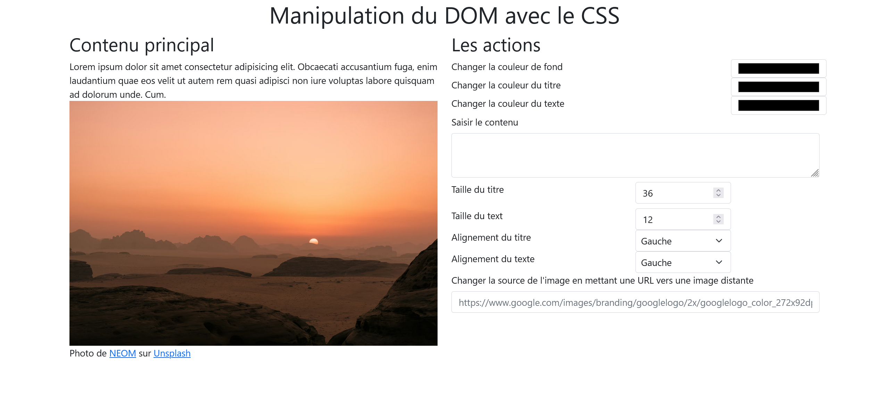

# Atelier 7.1 : les styles CSS

## Enoncé

1. Récupérez [ce code HTML](./resources/5.1/moyen-difficle/index.html) qui servira du point de départ
À l'aide des événements, modifiez les propriétés CSS ou le contenu des éléments du bloc de gauche.
Les actions à effectuer :
- Modifiez la couleur de fond ;
- Modifiez les couleurs du titre et du texte ;
- Modifiez les alignements du titre et du texte ;
- Modifiez ou ajoutez du contenu au texte initial ;
- Modifiez les tailles du titre et du texte ;
 - Modifiez l’apparence du curseur au survol de l'image en affichant tout en haut de la page le message "survol de l'image" ;

---

## Bonus

2. Faites fonctionner pour imagination pour ajouter tout ce qui vous passe par la tête. Par exemple, nouveaux champs, des événements, récupérez les infos du BOM et les exploiter, etc.

---

## Maquette de la page

