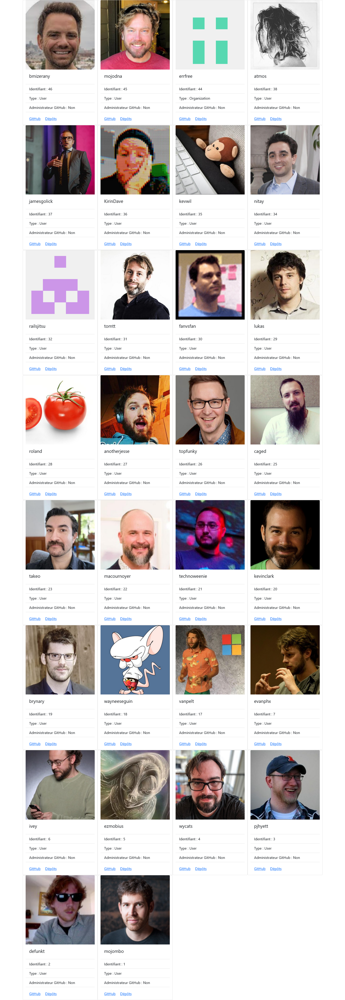

# Atelier 8.1 : requêtes avec un serveur

## Enoncé

1. Récupérez et affichez les utilisateurs GitHub à partir du lien de son API [https://api.github.com/users](https://api.github.com/users)

2. Affichez ces utilisateurs en vous appuyant sur les templates HTML ci-dessous.

## Spécifications techniques

- Vous devez récupérer de manière asynchrone les utilisateurs depuis GitHub et le template [page utilisateur](./ressources/8.1/user.html) également de manière asynchrone en remplaçant les motifs positionnés dans le template `{{SOMETHING}}` par la valeur correspondant aux données récupérées depuis GitHub.

### Templates HTML

- [Page accueil](./ressources/8.1/index.html)
- [Page utilisateur](./ressources/8.1/user.html)

---

### Illustration du résultat final

